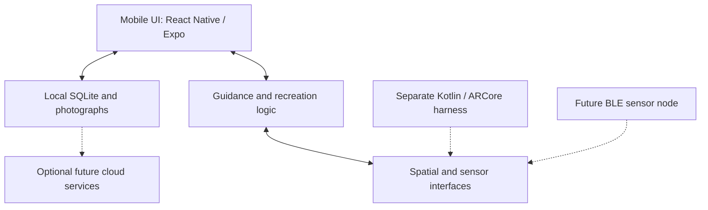

# LightGuide v2 — Commercial R&D

**Measure → Save → Recreate real photographic lighting setups.**

LightGuide helps photographers record a lighting setup and restore it later. The commercial direction combines a phone-led experience with candidate depth, spectral and orientation sensing. V1 focuses on recreation; artistic recommendations and subject-aware adaptation are later work.

## Current status — 29 September 2026

**The user selected the Codex application as the maintained implementation.** Its offline mobile app and hardened positioning harness are integrated alongside the current documentation. The current acceptance implementation aligns the maintained app with the approved 01–32 workflow references.

- [Mobile app and run instructions](apps/mobile/README.md): local SQLite, photographs, equipment/shoots, immutable versions, manual recreation and labelled simulation.
- Android display name is **LightGuide**, package `com.lightguide.codex`, version 0.2.0 / build 6. The unchanged package preserves the upgrade/data identity; the acceptance build is also tested from empty storage.
- A one-time, clearly labelled Soft portrait example makes clean-install evaluation possible without claiming simulated content is user data or a hardware reading.
- [Acceptance implementation and 01–32 parity](docs/validation/LIGHTGUIDE_ACCEPTANCE_2026-09-29.md) records the implemented flows, deliberate differences and remaining physical-hardware boundaries.
- Selected source: `d6110136934b3b78456a90b570d58ce00885145c`. [Its CI run](https://github.com/V-Vekaria/LightGuide-v2/actions/runs/34707182893) passed software, native positioning tests/build, Android packaging and emulator smoke checks. The integration also runs CI on main.
- Claude's alternative and superseded branches are retired from active development. [The cleanup record](docs/validation/BRANCH_CLEANUP_2026-09-14.md) records their exact tips, recovery tags and guarded deletion policy.
- Physical positioning accuracy, live mobile AR/BLE integration, calibrated sensors, cloud and iOS remain open.

Use `main` for new work. Historical comparison reports remain evidence, not instructions to maintain two applications. Read [current status](docs/STATUS.md) for remaining work.

## Photographer workflow

| Stage | Usable offline application journey | Live measured recreation goal |
|---|---|---|
| Capture | Name a setup; optionally add photos, equipment and manual details. Missing measurements stay unknown. | Establish the studio/subject reference and capture a valid light pose. |
| Save | Store a local setup version; preserve completed work across restart. | Retain reference identity, units, calibration and measurement provenance. |
| Recreate | Reopen the saved version and follow its photographs/settings; record the outcome. | Re-establish the reference and guide movement, height, direction and tilt from current measurements. |
| Recover | Preserve drafts, explain errors and provide manual fallback. | Withdraw Match when tracking is lost or stale; reacquire before resuming. |

A manual outcome or simulation is not a measured spatial match. Detailed screen and failure behaviour: [user workflows](docs/product/USER_WORKFLOWS.md). Testable checks: [application acceptance criteria](docs/engineering/APP_ACCEPTANCE.md).

## Architecture at a glance

This diagram describes the selected architecture and integration boundaries. Dashed connections are planned integrations, not current live capabilities of the evaluation app.

- **Phone:** primary UI, camera/visual positioning and computation. Android is the first test platform.
- **Local application:** TypeScript, Expo Development Builds, Expo Router and SQLite; offline capture and manual recreation work independently of the spatial experiment.
- **Spatial layer:** native Kotlin/ARCore measurement harness; a platform-neutral interface separates it from the app. Simulation/unavailable states must be explicit.
- **Node evaluation:** ESP32-S3-WROOM-1-N8R8 controller, VL53L5CX-class depth, AS7343 spectral and BNO086 orientation candidates. Exact received hardware, integration and performance require verification.
- **Later services:** optional authentication/backup/sync and recommendation intelligence. They must not become dependencies of the offline core.

Full [architecture](docs/V1_ARCHITECTURE.md), [data design](docs/product/DATABASE_DESIGN.md), [schema](docs/product/DATABASE_SCHEMA.md) and [decisions](docs/DECISIONS.md) own the details. Sensor interfaces, BLE and calibrated performance are not proven by this diagram.

## Documentation guide

| Need | Authoritative document |
|---|---|
| Problem, users, product goals and V1 scope | [PRD](docs/product/PRD.md), [product specification](docs/V1_PRODUCT_SPEC.md) |
| Screens, navigation, user journeys and recovery | [User workflows](docs/product/USER_WORKFLOWS.md), [application backlog](docs/product/APP_MVP_PLAN.md) |
| Requirements and acceptance criteria | [Engineering requirements](docs/engineering/ENGINEERING_REQUIREMENTS.md), [app acceptance](docs/engineering/APP_ACCEPTANCE.md) |
| System components and data flow | [Architecture](docs/V1_ARCHITECTURE.md) |
| Data relationships, versions and storage | [Database design](docs/product/DATABASE_DESIGN.md), [schema](docs/product/DATABASE_SCHEMA.md) |
| Offline sync, media, deletion and conflict rules | [Offline-sync specification](docs/product/OFFLINE_SYNC.md) |
| Hardware, component status and positioning research | [Evaluation BOM](docs/V1_BOM.md), [positioning research](docs/POSITIONING_RESEARCH.md) |
| Competitors and reuse opportunities | [Landscape](docs/product/COMPETITIVE_LANDSCAPE.md), [reuse research](docs/product/COMPETITOR_REUSE_RESEARCH_2026-09-10.md) |
| Milestones, priorities and Definition of Done | [Roadmap](docs/product/ROADMAP.md), [delivery handoff](docs/engineering/CLAUDE_BUILD_HANDOFF.md) |
| Testing, evidence and risks | [Test plan](docs/TEST_PLAN.md), [validation log](docs/validation/VALIDATION_LOG.md), [risk register](docs/validation/RISK_REGISTER.md) |
| Current branch/build status and remaining work | [Status](docs/STATUS.md), [branch evidence](docs/validation/BRANCH_STATUS_2026-09-14.md) |
| Contributor instructions and settled decisions | [AGENTS.md](AGENTS.md), [CLAUDE.md](CLAUDE.md), [decision record](docs/DECISIONS.md) |

The [documentation map](docs/DOCUMENTATION_MAP.md) provides the complete ownership guide. Core planning is sufficient for implementation and testing. Physical results, protocol decisions and release evidence must be updated as work progresses.

## Run and test the correct project

Use [apps/mobile/README.md](apps/mobile/README.md) for installation, prerequisites and commands. **Root npm commands exercise the legacy web prototype**, not the Android application. Continue the existing mobile app on main; do not scaffold another implementation.

Use the separate [Android experiment instructions](experiments/phase-0-ar-positioning/README.md) for exact registered marker assets and native measurements. Expo Go is not a native AR/BLE test environment. iOS requires future Apple development and test access.

## Release and validation boundaries

An installable offline prototype, a physically validated one-light system and a photographer-validated MVP are distinct milestones. Record commit, package/version, artifact identity, test environment and results for each release using [the acceptance record](docs/engineering/APP_ACCEPTANCE.md).

- Configured ±3 cm distance/height and ±3° direction/tilt tolerances are **targets**, not demonstrated accuracy.
- A 3–5 cm feasibility-screen result does not establish consistent ±3 cm performance.
- The [test plan](docs/TEST_PLAN.md) calls for repeated physical trials, independent ground truth and failure/outlier reporting.
- One physical node is validated first; data models anticipate multiple lights.
- The existing MVP plan requires evidence from five photographers.
- Production electronics, BLE integration, cloud sync and artistic AI remain subject to their own implementation and validation gates.

## Legacy and university boundaries

Root `src/`, `mock-device/`, `device/` and their tests are the earlier Preact/manual-target/Nano ESP32 prototype. Preserve their filtering, guidance, storage and conformance evidence; do not treat them as the new phone/BLE architecture. Historical plans are in [the legacy archive](docs/archive/legacy-companion/README.md).

[LightGuide-Edge](https://github.com/V-Vekaria/LightGuide-Edge) is the separate university project and remains independent.
