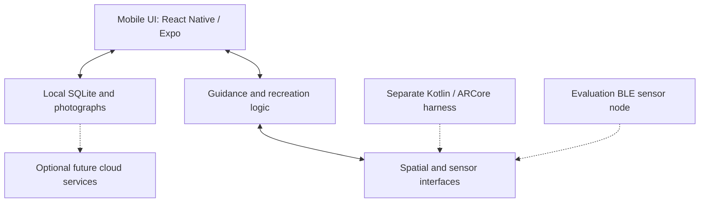

# LightGuide v2 — Commercial R&D

**Measure → Save → Recreate real photographic lighting setups.**

LightGuide helps photographers record a lighting setup and restore it later. The commercial direction combines a phone-led experience with candidate depth, spectral and orientation sensing. V1 focuses on recreation; artistic recommendations and subject-aware adaptation are later work.

## Current status — 6 October 2026

The maintained application is in `apps/mobile/`. **LightGuide 0.2.1 / Android build 9** uses package `com.lightguide.codex`. The current acceptance update is in [PR #24](https://github.com/V-Vekaria/LightGuide-v2/pull/24), branch `codex/lightguide-acceptance-v2`; it is not yet a verified release on `main`.

- Offline capture with photographs, equipment, multiple lights and optional camera settings.
- Saved setup library, immutable versions, archive/Trash/restore and full workspace backup/import.
- First-use preferences and a clearly labelled Soft portrait example and guided simulation.
- Freely navigable recreation phases, persisted readings requiring rechecking after interruption, and explicit photographer-reported outcomes.
- Shoot planning with past-date validation and Europe/London calendar-day grouping.
- App-owned foreground BLE session, connection status and stale-reading handling are implemented; physical phone-to-node operation and calibrated accuracy still need acceptance testing.

[Run 36813426780](https://github.com/V-Vekaria/LightGuide-v2/actions/runs/36813426780) passed all four jobs on 1 October 2026 for source `adbb073c427f417a745390a85043d1e5e7a91eaf`: software/browser checks, positioning unit tests/build, Android packaging and Android install/upgrade/offline smoke. The smoke log confirms saved-data retention during an in-place upgrade, repeated Settings navigation, offline reopening and Camera-to-Lights reading retention. The `lightguide-codex-android` artifact was available on 6 October. **This is emulator/software evidence; physical phone acceptance, BLE and calibrated accuracy remain pending.** See [the acceptance record](docs/validation/LIGHTGUIDE_ACCEPTANCE_2026-09-29.md) for earlier evidence and limitations. Documentation-only follow-ups do not change the tested application binary.

Continue this acceptance work in PR #24; use `main` as the baseline for unrelated new work. The old Codex/Claude comparison is finished: [retired implementations and recovery tags](docs/validation/BRANCH_CLEANUP_2026-09-14.md) are historical context. [Current status](docs/STATUS.md) tracks remaining product work.

## Download and update Android

1. Open the [acceptance CI run](https://github.com/V-Vekaria/LightGuide-v2/actions/runs/36813426780) while signed into GitHub with access to this repository.
2. Confirm **software**, **positioning**, **android** and **android-smoke** all passed for the candidate. Until then, treat its APK as unverified.
3. Under **Artifacts**, download **lightguide-codex-android** and extract the ZIP. The mobile APK is `app-release.apk`; the separate positioning artifact is a research harness.
4. Back up important work through the app's **Data & backup** screen, then open the APK and choose **Update** over the existing LightGuide installation.
5. **Do not uninstall or clear storage to update.** If Android rejects the update, retain the installed app and report the error; package identity alone does not guarantee signing compatibility.

The evaluation APK uses development signing and is not a Play Store release. Android Studio is not needed to install it. Artifact downloads can expire; use the exact verified run rather than an arbitrary newer build. See [mobile build and test instructions](apps/mobile/README.md).

## Photographer workflow

| Stage | Usable offline application journey | Live measured recreation goal |
|---|---|---|
| Capture | Name a setup; optionally add photos, equipment and manual details. Missing measurements stay unknown. | Establish the studio/subject reference and capture a valid light pose. |
| Save | Store a local setup version; preserve completed work across restart. | Retain reference identity, units, calibration and measurement provenance. |
| Recreate | Reopen the saved version and follow its photographs/settings; record the outcome. | Re-establish the reference and guide movement, height, direction and tilt from current measurements. |
| Recover | Preserve drafts, explain errors and provide manual fallback. | Withdraw Match when tracking is lost or stale; reacquire before resuming. |

A manual outcome or simulation is not a measured spatial match. Detailed screen and failure behaviour: [user workflows](docs/product/USER_WORKFLOWS.md). Testable checks: [application acceptance criteria](docs/engineering/APP_ACCEPTANCE.md).

## Architecture at a glance

This diagram describes the selected architecture and integration boundaries. Dashed connections require further integration or physical validation; the app-side BLE adapter exists, but an end-to-end hardware result is not yet verified.

- **Phone:** primary UI, camera/visual positioning and computation. Android is the first test platform.
- **Local application:** TypeScript, Expo Development Builds, Expo Router and SQLite; offline capture and manual recreation work independently of the spatial experiment.
- **Spatial layer:** native Kotlin/ARCore measurement harness; a platform-neutral interface separates it from the app. Simulation/unavailable states must be explicit.
- **Node evaluation:** received ESP32-S3 N16R8 controller, VL53L5CX depth, AS7343 light/spectral sensor and Adafruit BNO085 orientation sensor over UART. Component bench evidence is recorded in the [evaluation BOM](docs/V1_BOM.md); complete BLE integration, calibration and positioning accuracy remain unverified.
- **Later services:** optional authentication/backup/sync and recommendation intelligence. They must not become dependencies of the offline core.

Full [architecture](docs/V1_ARCHITECTURE.md), [data design](docs/product/DATABASE_DESIGN.md), [schema](docs/product/DATABASE_SCHEMA.md) and [decisions](docs/DECISIONS.md) own the details. Sensor interfaces, BLE and calibrated performance are not proven by this diagram.

## Documentation guide

| Need | Authoritative document |
|---|---|
| Problem, users, product goals and V1 scope | [PRD](docs/product/PRD.md), [product specification](docs/V1_PRODUCT_SPEC.md) |
| Screens, navigation, user journeys and recovery | [User workflows](docs/product/USER_WORKFLOWS.md), [application backlog](docs/product/APP_MVP_PLAN.md) |
| Requirements and acceptance criteria | [Engineering requirements](docs/engineering/ENGINEERING_REQUIREMENTS.md), [app acceptance](docs/engineering/APP_ACCEPTANCE.md) |
| System components and data flow | [Architecture](docs/V1_ARCHITECTURE.md) |
| Data relationships, versions and storage | [Database design](docs/product/DATABASE_DESIGN.md), [schema](docs/product/DATABASE_SCHEMA.md) |
| Offline sync, media, deletion and conflict rules | [Offline-sync specification](docs/product/OFFLINE_SYNC.md) |
| Hardware, component status and positioning research | [Evaluation BOM](docs/V1_BOM.md), [positioning research](docs/POSITIONING_RESEARCH.md) |
| Competitors and reuse opportunities | [Landscape](docs/product/COMPETITIVE_LANDSCAPE.md), [reuse research](docs/product/COMPETITOR_REUSE_RESEARCH_2026-09-10.md) |
| Milestones, priorities and Definition of Done | [Roadmap](docs/product/ROADMAP.md), [delivery handoff](docs/engineering/CLAUDE_BUILD_HANDOFF.md) |
| Testing, evidence and risks | [Test plan](docs/TEST_PLAN.md), [validation log](docs/validation/VALIDATION_LOG.md), [risk register](docs/validation/RISK_REGISTER.md) |
| Current branch/build status and remaining work | [Status](docs/STATUS.md), [branch evidence](docs/validation/BRANCH_STATUS_2026-09-14.md) |
| Contributor instructions and settled decisions | [AGENTS.md](AGENTS.md), [CLAUDE.md](CLAUDE.md), [decision record](docs/DECISIONS.md) |

The [documentation map](docs/DOCUMENTATION_MAP.md) provides the complete ownership guide. Core planning is sufficient for implementation and testing. Physical results, protocol decisions and release evidence must be updated as work progresses.

## Run and test the correct project

Use [apps/mobile/README.md](apps/mobile/README.md) for installation, prerequisites and commands. **Root npm commands exercise the legacy web prototype**, not the Android application. Continue the existing mobile app; PR #24 holds the current acceptance candidate. Do not scaffold another implementation.

Use the separate [Android experiment instructions](experiments/phase-0-ar-positioning/README.md) for exact registered marker assets and native measurements. Expo Go is not a native AR/BLE test environment. iOS requires future Apple development and test access.

## Release and validation boundaries

An installable offline prototype, a physically validated one-light system and a photographer-validated MVP are distinct milestones. Record commit, package/version, artifact identity, test environment and results for each release using [the acceptance record](docs/engineering/APP_ACCEPTANCE.md).

- Configured ±3 cm distance/height and ±3° direction/tilt tolerances are **targets**, not demonstrated accuracy.
- A 3–5 cm feasibility-screen result does not establish consistent ±3 cm performance.
- The [test plan](docs/TEST_PLAN.md) calls for repeated physical trials, independent ground truth and failure/outlier reporting.
- One physical node is validated first; data models anticipate multiple lights.
- The existing MVP plan requires evidence from five photographers.
- Production electronics, BLE integration, cloud sync and artistic AI remain subject to their own implementation and validation gates.

## Legacy and university boundaries

Root `src/`, `mock-device/`, `device/` and their tests are the earlier Preact/manual-target/Nano ESP32 prototype. Preserve their filtering, guidance, storage and conformance evidence; do not treat them as the new phone/BLE architecture. Historical plans are in [the legacy archive](docs/archive/legacy-companion/README.md).

[LightGuide-Edge](https://github.com/V-Vekaria/LightGuide-Edge) is the separate university project and remains independent.
